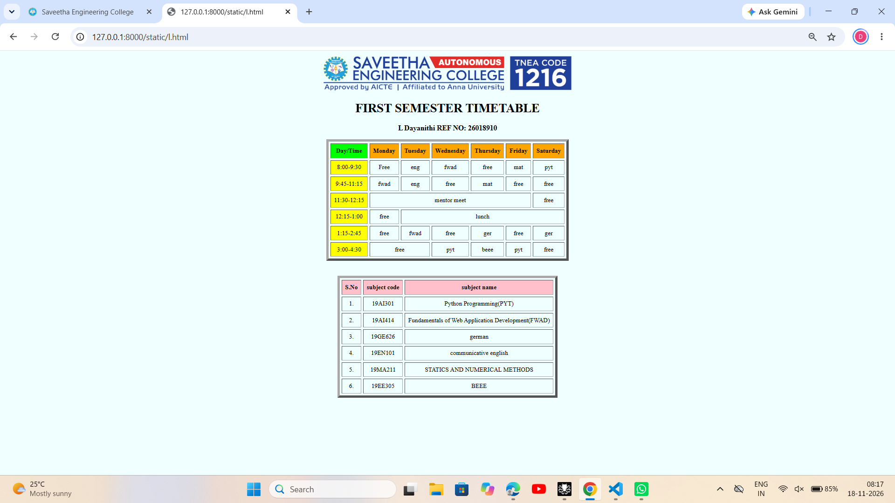

# Ex04 Time Table
## Date:18/11/2026

## AIM
To write a html webpage page to display your slot timetable.

## ALGORITHM
### STEP 1
Create a Django-admin Interface.

### STEP 2
Create an App inside the Django project.

### STEP 2
Create a static folder uder the created App and insert HTML code.

### STEP 3
Create a simple table using ```<table>``` tag in html with the relevant attributes.

### STEP 4
Add rows using ```<tr>``` tag.

### STEP 5
Add your course schedule using ```<td>``` tag.

### STEP 6
Execute the program using runserver command.

## PROGRAM
```
<html>
    <head>
        <title></title>
    </head>
    <body bgcolor="azure">
        <center>
        
        </center>
        <h1 align="center"><b>FIRST SEMESTER TIMETABLE</b></h1>
        <h3 align="center"><b>L Dayanithi REF NO: 26018910</b></h3>
        <table border="6" cellspacing="5" cellpadding="8" align="center">
            <tr bgcolor="orange" align="center">
                <th bgcolor="lime">Day/Time</th>
                <th>Monday</th>
                <th>Tuesday</th>
                <th>Wednesday</th>
                <th>Thursday</th>
                <th>Friday</th>
                <th>Saturday</th>
            </tr>
            <tr align="center">
                <td bgcolor="yellow">8:00-9:30</td>
                <td>Free</td>
                <td>eng</td>
                <td>fwad</td>
                <td>free</td>
                <td>mat</td>
                <td>pyt</td>        
            <tr align="center">
                <td bgcolor="yellow">9:45-11:15</td>
                <td>fwad</td>
                <td>eng</td>
                <td>free</td>
                <td>mat</td>
                <td>free</td>
                <td>free</td>
            </tr>
            <tr align="center">
                <td bgcolor="yellow">11:30-12:15</td>
                <td colspan="5">mentor meet</td>
                <td>free</td>
            </tr>
            <tr align="center">
                <td bgcolor="yellow">12:15-1:00</td>
                <td>free</td>
                <td colspan="5">lunch</td>
            </tr>
            <tr align="center">
                <td bgcolor="yellow">1:15-2:45</td>
                <td>free</td>
                <td>fwad</td>
                <td>free</td>
                <td>ger</td>
                <td>free</td>
                <td>ger</td>
            </tr>
            <tr align="center">
                <td bgcolor="yellow">3:00-4:30</td>
                <td colspan="2">free</td>
                <td>pyt</td>
                <td>beee</td>
                <td>pyt</td>
                <td>free</td>
            </tr>
           </table>       
           <br><br><table border="6" cellspacing="5" cellpadding="8" align="center">
            <tr bgcolor="pink" align="center">
                <th>S.No</th>
                <th>subject code</th>
                <th>subject name</th>              
            </tr>
            <tr align="center">
                <td>1.</td>
                <td>19AI301</td>
                <td>Python Programming(PYT)</td>
            </tr>
            <tr align="center">
                <td>2.</td>
                <td>19AI414</td>
                <td>Fundamentals of Web Application Development(FWAD)</td>
            </tr>
         
       

             <tr align="center">
                <td>3.</td>
                <td>19GE626</td>
                <td>german</td>
            </tr>
            <tr align="center">
                <td>4.</td>
                <td>19EN101</td>
                <td>communicative english</td>
            </tr>
            <tr align="center">
                <td>5.</td>
                <td>19MA211</td>
                <td>STATICS AND NUMERICAL METHODS</td>
            </tr>
            <tr align="center">
                <td>6.</td>
                <td>19EE305</td>
                <td>BEEE</td>
            </tr>
           </table>         
    </body>
</html>
```

## OUTPUT


## RESULT
The program for creating slot timetable using basic HTML tags is executed successfully.
